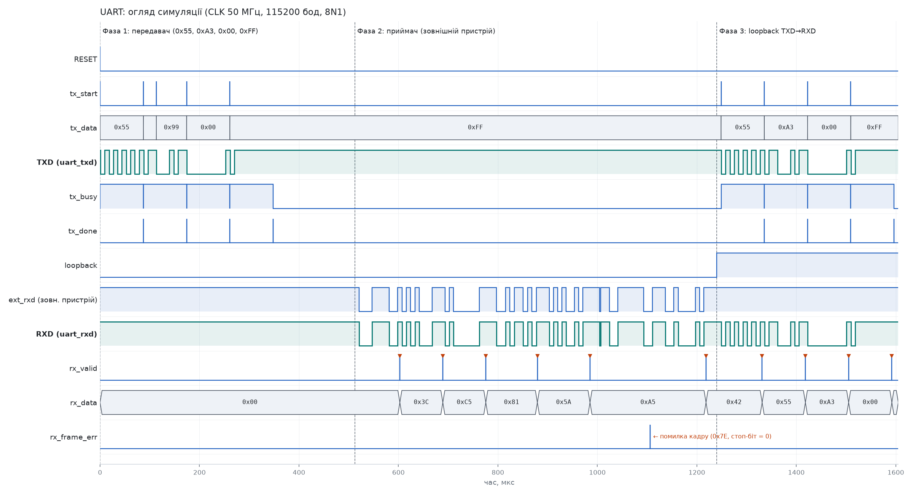
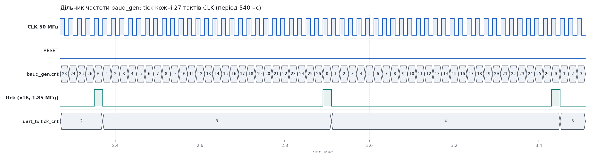
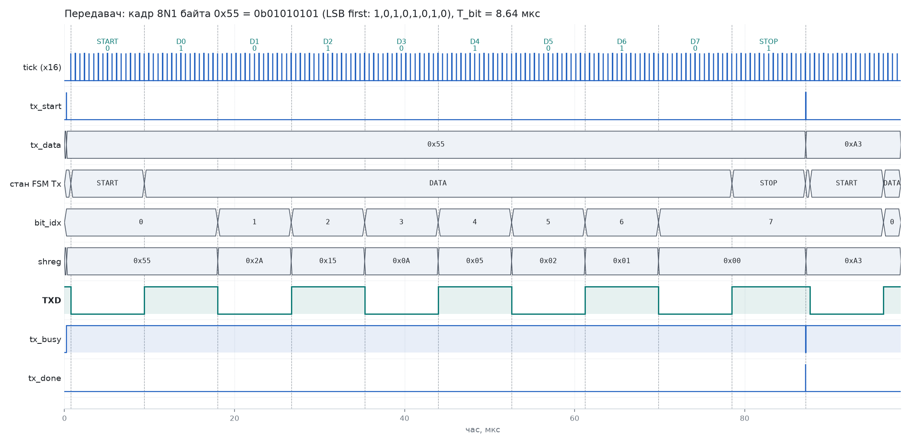
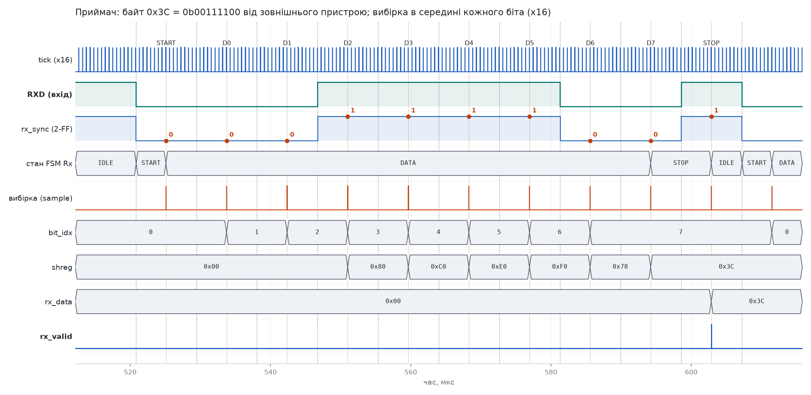
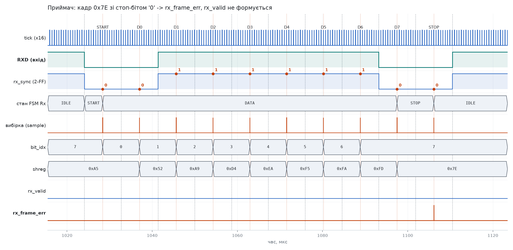
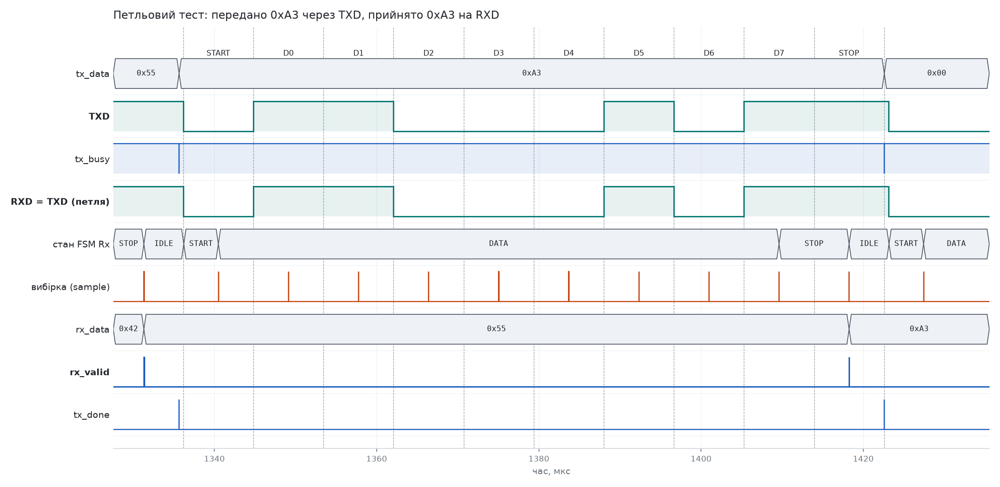

# Лабораторна робота №3 — UART на VHDL

[](https://github.com/oleksandrtargaryen/apks-lab3-uart-vhdl/actions/workflows/sim.yml)

**Тема:** Розробка та верифікація послідовних комунікаційних протоколів на ПЛІС

- **Студент:** Бартошко Олександр Ігорович
- **Група:** КІ-408
- **Варіант:** 1 — протокол **UART**, мова **VHDL** (VHDL-2008)

## Параметри реалізації

| Параметр | Значення |
|---|---|
| Системний такт | 50 МГц |
| Швидкість | 115 200 бод (дільник 27 × 16 → реально 115 741 бод, похибка +0,47 %) |
| Формат кадру | 8N1: старт `0`, 8 біт даних LSB first, стоп `1`, без парності |
| Приймач | 2-FF синхронізатор, 16× передискретизація, перевірка старт-біта в середині, вибірка в середині кожного біта, прапорець помилки кадру |
| Скидання | синхронне, активний рівень `1` |

## Структура репозиторію

```
rtl/
  baud_gen.vhd    — дільник частоти: імпульси tick = BAUD × 16 (clock enable)
  uart_tx.vhd     — передавач, FSM IDLE/START/DATA/STOP, tx_busy, tx_done
  uart_rx.vhd     — приймач, FSM IDLE/START/DATA/STOP, rx_valid, rx_frame_err
  uart_top.vhd    — верхній рівень: baud_gen + uart_tx + uart_rx
tb/
  tb_uart.vhd     — самоперевірний тестбенч (assert/report, "TEST PASSED")
sim/
  run_sim.sh      — аналіз/елаборація/запуск у GHDL, VCD → build/uart.vcd
scripts/
  plot_waves.py   — PNG-осцилограми з VCD (matplotlib)
  render_fsm.py   — PNG-діаграми станів (Graphviz)
docs/
  fsm.md          — діаграми станів (Mermaid) та опис логіки приймача
  img/            — осцилограми та діаграми FSM
.github/workflows/sim.yml — CI: симуляція в GHDL на кожен push/PR
Makefile          — цілі sim, sim-fast, waves, fsm, synth, clean
```

## Модулі

```
            +-----------+  tick (x16)
   clk ---->| baud_gen  |--------+------------+
            +-----------+        |            |
                            +----v----+  +----v----+
 tx_start, tx_data -------->| uart_tx |  | uart_rx |<---- uart_rxd
 tx_busy, tx_done <---------|         |  |         |----> rx_data, rx_valid,
              uart_txd <----|         |  |         |      rx_frame_err
                            +---------+  +---------+
```

Діаграми станів передавача та приймача — у [docs/fsm.md](docs/fsm.md).

## Як запустити симуляцію

Потрібно: [GHDL](https://github.com/ghdl/ghdl) ≥ 3.0 (macOS: `brew install ghdl`,
Ubuntu: `apt install ghdl`), для осцилограм — Python 3 + matplotlib, для FSM — Graphviz.

```bash
make sim          # або ./sim/run_sim.sh — реальні параметри 50 МГц / 115200 бод
make sim-fast     # швидкий режим (781250 бод), та сама логіка перевірок
make waves        # docs/img/wave_*.png з build/uart.vcd
make gtkwave      # перегляд build/uart.vcd у GTKWave
```

Скрипт завершується з ненульовим кодом, якщо спрацював `assert ... severity failure`
або в лозі немає рядка `TEST PASSED`.

### Що перевіряє тестбенч

1. **Скидання:** після RESET лінія TXD = `1`, `tx_busy = 0`.
2. **Передавач:** байти `0x55, 0xA3, 0x00, 0xFF` подаються «впритул». Незалежний
   TB-декодер лінії TXD перевіряє старт-біт, 8 біт даних (LSB first), стоп-біт і те,
   що кожна зміна лінії відбувається точно на межі біта (T_bit = 8,64 мкс);
   тривалість кадру від спаду старт-біта до `tx_done` = 10·T_bit = 86,4 мкс.
   Запит `tx_start` під час передачі ігнорується.
3. **Приймач:** модель зовнішнього пристрою (асинхронна до `clk`) надсилає
   `0x3C, 0xC5, 0x81` без пауз, `0x5A`/`0xA5` з розбіжністю швидкості −3 %/+3 %,
   коротку заваду (¼ біта — має бути відкинута), кадр `0x7E` зі стоп-бітом `0`
   (очікується `rx_frame_err` без `rx_valid`) та `0x42` після помилки.
4. **Петля TXD → RXD:** `0x55, 0xA3, 0x00, 0xFF` передаються і приймаються одночасно.

Результат (`build/sim_log.txt`):

```
SUMMARY: TX frames checked = 8, RX bytes checked = 10, framing errors detected = 1 (expected 1)
TEST PASSED
```

## Осцилограми

| | |
|---|---|
| Огляд усієї симуляції |  |
| CLK 50 МГц і дільник baud_gen |  |
| Кадр передавача 0x55 |  |
| Прийом 0x3C |  |
| Помилка кадру |  |
| Петльовий тест 0xA3 |  |

## Синтез

Синтез і часовий аналіз (етап 4: Yosys + nextpnr для Lattice iCE40 HX8K, ct256)
виконуються після схвалення етапу 3 у гілці `feature/develop/4-synthesis`
(`make synth`).

## Git-процес

`master` → `develop` → `feature/develop/3-uart` (RTL + тестбенч) → PR `lab2/testbench`
у `develop` з рев'ю викладача → після схвалення — `feature/develop/4-synthesis`.
