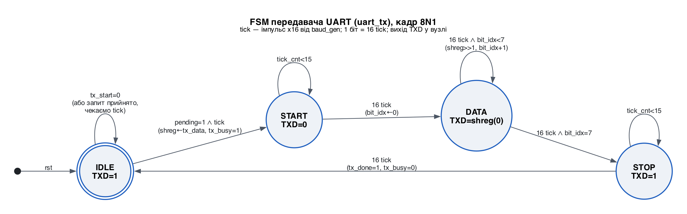
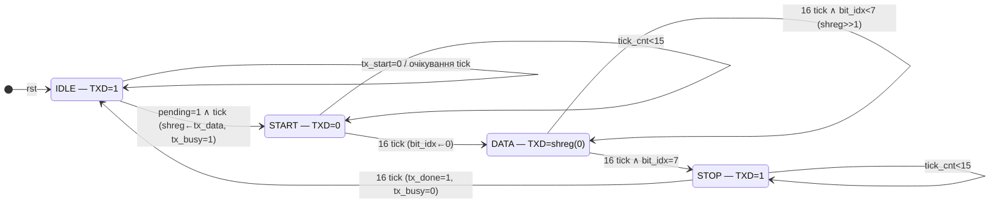
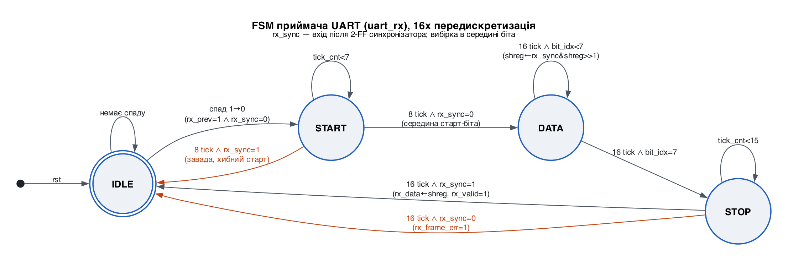
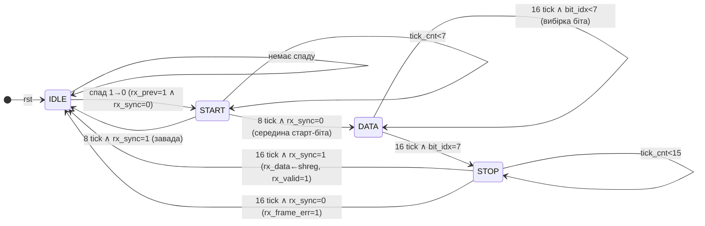

# Діаграми станів (FSM) UART

Лабораторна робота №3 · Бартошко О.І., КІ-408 · варіант 1 (UART / VHDL)

Формат кадру — **8N1**: 1 старт-біт (`0`), 8 біт даних (молодший біт першим, LSB first),
1 стоп-біт (`1`), без біта парності. Лінія у стані спокою — `1`.

Тактування: системний такт `clk` = 50 МГц; `baud_gen` формує імпульс дозволу `tick`
кожні 27 тактів (50 000 000 / (115 200 · 16) ≈ 27,13 → 27), тобто з частотою
≈ 1,852 МГц = 16 × 115 741 бод (похибка +0,47 %). Один біт = 16 імпульсів `tick` =
432 такти = 8,64 мкс.

PNG-версії діаграм: [`img/fsm_tx.png`](img/fsm_tx.png), [`img/fsm_rx.png`](img/fsm_rx.png)
(генеруються `python3 scripts/render_fsm.py`).

## Передавач (uart_tx)

| Стан  | TXD        | Дія / умова переходу |
|-------|------------|----------------------|
| IDLE  | `1`        | Імпульс `tx_start` фіксує `tx_data` у зсувному регістрі `shreg`, встановлює `pending` і `tx_busy`. Перехід у START відбувається на найближчому `tick`, тому старт-біт вирівняний по сітці `tick` і всі біти мають однакову тривалість. Запити під час `tx_busy=1` ігноруються. |
| START | `0`        | Старт-біт: 16 імпульсів `tick`. Далі на лінію виводиться D0. |
| DATA  | `shreg(0)` | Кожні 16 `tick` регістр зсувається вправо, `bit_idx` збільшується; після D7 → STOP. |
| STOP  | `1`        | Стоп-біт 16 `tick`; потім імпульс `tx_done` (1 такт), `tx_busy=0`, перехід в IDLE. |

## Приймач (uart_rx)

### Логіка роботи приймача

1. **Синхронізатор.** Асинхронний вхід `rxd` проходить через два тригери
   (`rx_meta` → `rx_sync`), що усуває метастабільність; третій тригер `rx_prev`
   використовується для виявлення спаду `1 → 0` (початок старт-біта).
2. **IDLE.** Очікування спаду лінії. Реагування саме на спад (а не на рівень `0`)
   гарантує, що після помилки кадру, коли лінія ще в `0`, хибний старт не виникне.
3. **START.** Відлік 8 імпульсів `tick` (половина біта). Якщо в середині старт-біта
   лінія все ще `0` — старт підтверджено; інакше це завада, повернення в IDLE.
4. **DATA.** Від середини старт-біта кожні 16 `tick` — середина наступного біта даних.
   Біт вдвигається в старший розряд `shreg` (`shreg ← rx_sync & shreg(7..1)`),
   тож після 8 зсувів D0 опиняється в `shreg(0)` (LSB first).
5. **STOP.** У середині стоп-біта лінія має бути `1`: тоді `rx_data ← shreg` та
   імпульс `rx_valid`; інакше — імпульс `rx_frame_err`, `rx_data` не змінюється.
   Перехід в IDLE з середини стоп-біта дозволяє приймати кадри «впритул».

Вибірка в середині біта дає запас ≈ ±(0,5 − 1/16) біта на 9,5 біта кадру, тобто
допустима розбіжність швидкостей передавача і приймача ≈ ±4,6 %. Тестбенч перевіряє
прийом при розбіжності ±3 %.
